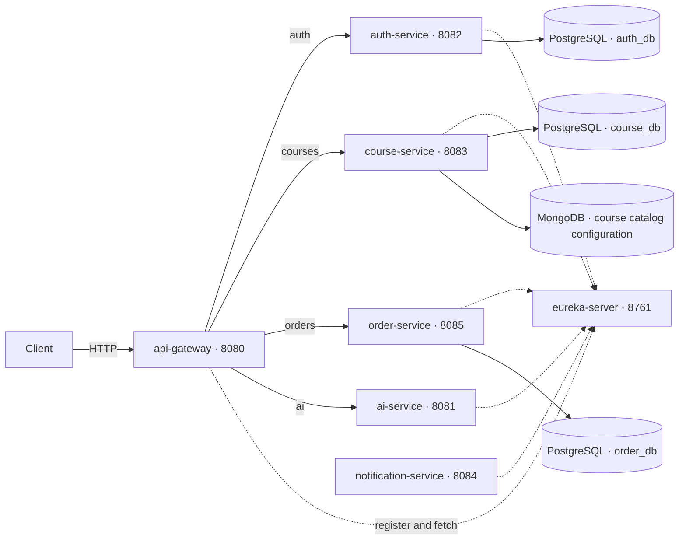

# Runtime architecture and HTTP surface

The Maven reactor builds seven Spring Boot applications. The registry and gateway provide infrastructure. Auth implements registration, current-user lookup, BCrypt password hashing and HTTP Basic authentication. The gateway validates Basic credentials with auth-service and forwards signed-in identity headers to downstream services. Course now exposes a public catalogue plus instructor/admin write endpoints backed by JPA and MapStruct. Order, notification and AI still have application entry points and persistence dependencies without business handlers. The database design in this directory describes a larger LMS than the Java applications currently implement. [Reactor POM](../pom.xml) · [Database design](attribute-guide.md)

## Request and discovery paths

The solid links show configured HTTP routes and database integrations. Dotted links show Eureka registration and registry fetches. Each client prefers an IP address and includes a random UUID in its instance ID. Eureka runs as a standalone registry with self-preservation enabled and peer registration and fetching disabled. [Gateway configuration](../api-gateway/src/main/resources/application.properties) · [Registry configuration](../eureka-server/src/main/resources/application.properties) · [Registry entry point](../eureka-server/src/main/java/in/iamandroid/eureka/EurekaServerApplication.java)

## Modules and implemented capabilities

| Module | Default port | What the source or packaged dependencies establish |
| --- | ---: | --- |
| [eureka-server](../eureka-server/pom.xml) | 8761 | `@EnableEurekaServer` activates the Eureka registry and dashboard. This module inherits directly from the Boot parent and imports the Cloud BOM itself. |
| [api-gateway](../api-gateway/pom.xml) | 8080 | Reactive Spring Cloud Gateway Server WebFlux, Eureka client and load balancing. Four explicit routes. A global filter validates Basic credentials with auth-service and injects `X-User-Id`, `X-User-Email` and `X-User-Roles` after removing client-supplied values. Automatic discovery routes are disabled. |
| [ai-service](../ai-service/pom.xml) | 8081 | Servlet MVC application and Eureka client. Its properties reference PostgreSQL `ai_db`, but the packaged application has no JDBC driver or JPA integration. No search or model invocation is implemented. |
| [auth-service](../auth-service/pom.xml) | 8082 | Servlet MVC, Spring Security, JPA and PostgreSQL. Application code defines `POST /api/v1/auth/register`, `GET /api/v1/auth/me`, a BCrypt encoder, a custom user-details service and role assignment on registration. No token issuance or SSO is implemented. |
| [course-service](../course-service/pom.xml) | 8083 | Servlet MVC, validation, Spring Security, JPA/PostgreSQL, MongoDB and MapStruct. Mapped entities form the catalog; `GET` endpoints are public and write endpoints require `ROLE_ADMIN` or `ROLE_INSTRUCTOR` from the gateway identity headers. |
| [notification-service](../notification-service/pom.xml) | 8084 | Servlet MVC and Eureka client. No explicit gateway route, message listener, delivery handler or persistence integration. |
| [order-service](../order-service/pom.xml) | 8085 | Servlet MVC, validation, JPA and PostgreSQL. No checkout, payment callback, refund handler or order-event publisher. |

The root POM supplies the Eureka client to its six children. The gateway also imports the same Cloud BOM locally. There is no Java `learning-service` or audit module in the reactor. [Root dependency and module definitions](../pom.xml)

## Gateway HTTP contract

| Incoming path at port 8080 | HTTP method predicate | Upstream URI |
| --- | --- | --- |
| `/api/v1/auth/**` | Any | `lb://AUTH-SERVICE` |
| `/api/v1/courses/**` | Any | `lb://COURSE-SERVICE` |
| `/api/v1/orders/**` | Any | `lb://ORDER-SERVICE` |
| `/api/v1/ai/**` | Any | `lb://AI-SERVICE` |

These path predicates select an upstream by service ID. The routes configure no prefix stripping, retry filter, or custom response format. The gateway forwards the original path. `POST /api/v1/auth/register` and actuator paths are public; other paths require Basic credentials that the gateway checks against auth-service before forwarding. The configured upstream connect timeout is 5,000 ms and the response timeout is 30 seconds. A matching route can still fail when no instance is available, when validation rejects the request, or when the upstream has no matching handler. [Route definitions and HTTP client settings](../api-gateway/src/main/resources/application.properties)

## Framework endpoints and security

| Surface | Request | Purpose and response behavior |
| --- | --- | --- |
| Eureka dashboard | `GET /` on registry | Framework HTML view of registry status and registered instances. |
| Eureka registry | `GET /eureka/apps` on registry | Framework registry document. A client can request JSON using `Accept: application/json`. The process needs time to register and refresh after startup. |
| Registry management | `GET /actuator/health`, `/actuator/info`, `/actuator/metrics` on registry | The registry packages Actuator, health and Micrometer metrics. Properties request these endpoints and set health details to `never`. Responses describe the application and meter state. |
| Auth registration | `POST /api/v1/auth/register` | Public. Accepts an email and password, encodes the password with BCrypt, assigns `ROLE_TRAINEE` and returns the created user. |
| Auth current user | `GET /api/v1/auth/me` | Requires HTTP Basic authentication and returns the caller's id, email, roles and enabled flag. |
| Gateway identity headers | Any other routed request | Requires HTTP Basic authentication. Invalid or missing credentials receive `401`. Valid credentials produce `X-User-Id`, `X-User-Email` and `X-User-Roles` headers that downstream services use for authorization. |

No JWT or SSO is implemented. HTTP Basic is the local development credential transport; a production design should replace it with a token issued by a trusted identity provider. Course and order trust only the identity headers injected by the gateway, so their direct ports are not an external authorization boundary. The registry uses HTTP and has no repository-defined access policy. [Auth security configuration](../auth-service/src/main/java/in/iamandroid/authservice/config/SecurityConfig.java) · [Gateway identity filter](../api-gateway/src/main/java/in/iamandroid/apigateway/security/AuthHeadersGatewayFilter.java) · [Course security configuration](../course-service/src/main/java/in/iamandroid/course/config/SecurityConfig.java) · [Registry settings](../eureka-server/src/main/resources/application.properties)

## Catalogue HTTP contract

| Request | Authorization | Handler behavior |
| --- | --- | --- |
| `GET /api/v1/courses/categories` | Public | Lists category responses. |
| `POST /api/v1/courses/categories` | `ROLE_ADMIN` or `ROLE_INSTRUCTOR` | Creates a category; conflicting name or slug returns `409`. |
| `GET /api/v1/courses` | Public | Lists courses with nested modules and lessons. |
| `GET /api/v1/courses/{slug}` | Public | Returns one course by slug or `404`. |
| `POST /api/v1/courses` | `ROLE_ADMIN` or `ROLE_INSTRUCTOR` | Creates a course for the authenticated instructor id. |
| `POST /api/v1/courses/{courseId}/modules` | `ROLE_ADMIN` or `ROLE_INSTRUCTOR` | Adds a module at a unique position in the course. |
| `POST /api/v1/courses/{courseId}/modules/{moduleId}/lessons` | `ROLE_ADMIN` or `ROLE_INSTRUCTOR` | Adds a lesson at a unique position in the module. |

Validation failures return `400` with `VALIDATION_FAILED`; missing identity returns `401` and insufficient role returns `403`. [Course controller](../course-service/src/main/java/in/iamandroid/course/controller/CourseController.java) · [Exception handler](../course-service/src/main/java/in/iamandroid/course/exception/GlobalExceptionHandler.java)

## Logging and monitoring

All seven property files request management exposure for `health,info,metrics,prometheus` and specify an application metric tag. In the inspected service JARs, only Eureka includes Actuator, and none includes the Prometheus registry. The source tree supplies no Prometheus scrape configuration, Grafana dashboards, centralized log configuration or tracing collector. A management property alone does not establish a running scrape endpoint. [Registry management properties](../eureka-server/src/main/resources/application.properties) · [Gateway management properties](../api-gateway/src/main/resources/application.properties)

The applications use Boot's default logging configuration. Auth, course and order enable Hibernate SQL display and formatting. AI also sets these properties, although its packaging lacks the persistence stack. Before running a service, review its actual configuration and use local overrides for database credentials and the course MongoDB connection. The course defaults include a credential-bearing external MongoDB URI. [Course configuration](../course-service/src/main/resources/application.properties) · [Order configuration](../order-service/src/main/resources/application.properties) · [AI configuration](../ai-service/src/main/resources/application.properties)
