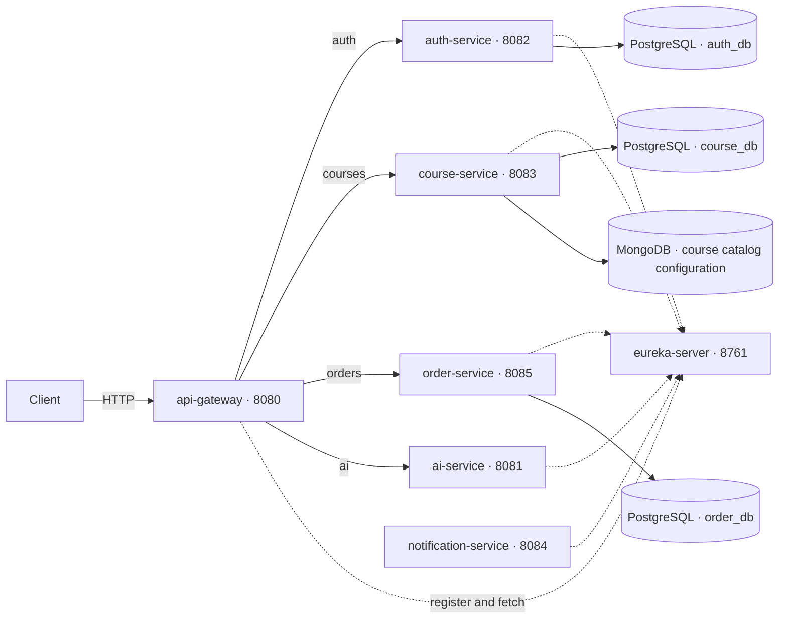

# Runtime architecture and HTTP surface

The Maven reactor builds seven Spring Boot applications. The registry and gateway provide infrastructure. Auth implements registration, current-user lookup, BCrypt password hashing and HTTP Basic authentication. The gateway validates Basic credentials with auth-service, forwards signed-in identity headers to downstream services and answers browser CORS preflights. Course exposes a public catalogue plus instructor/admin write endpoints backed by JPA and MapStruct. The catalogue carries type, category, duration, rating, student-count, tag and image metadata and is seeded from a classpath JSON dataset of 50 published items. Order now exposes enrolment and lesson-progress endpoints backed by JPA; progress percentages come from a small course-service lesson-count endpoint. Notification and AI still have application entry points and persistence dependencies without business handlers. The database design in this directory describes a larger LMS than the Java applications currently implement. [Reactor POM](../pom.xml) · [Database design](attribute-guide.md)

## Request and discovery paths



The solid links show configured HTTP routes and database integrations. Dotted links show Eureka registration and registry fetches. Each client prefers an IP address and includes a random UUID in its instance ID. Eureka runs as a standalone registry with self-preservation enabled and peer registration and fetching disabled. [Gateway configuration](../api-gateway/src/main/resources/application.properties) · [Registry configuration](../eureka-server/src/main/resources/application.properties) · [Registry entry point](../eureka-server/src/main/java/in/iamandroid/eureka/EurekaServerApplication.java)

## Modules and implemented capabilities

| Module | Default port | What the source or packaged dependencies establish |
| --- | ---: | --- |
| [eureka-server](../eureka-server/pom.xml) | 8761 | `@EnableEurekaServer` activates the Eureka registry and dashboard. This module inherits directly from the Boot parent and imports the Cloud BOM itself. |
| [api-gateway](../api-gateway/pom.xml) | 8080 | Reactive Spring Cloud Gateway Server WebFlux, Eureka client and load balancing. Four explicit routes. A global filter validates Basic credentials with auth-service and injects `X-User-Id`, `X-User-Email` and `X-User-Roles` after removing client-supplied values. A high-precedence `CorsWebFilter` answers `/api/v1/**` preflights before identity validation. Automatic discovery routes are disabled. |
| [ai-service](../ai-service/pom.xml) | 8081 | Servlet MVC application and Eureka client. Its properties reference PostgreSQL `ai_db`, but the packaged application has no JDBC driver or JPA integration. No search or model invocation is implemented. |
| [auth-service](../auth-service/pom.xml) | 8082 | Servlet MVC, Spring Security, JPA and PostgreSQL. Application code defines `POST /api/v1/auth/register`, `GET /api/v1/auth/me`, a BCrypt encoder, a custom user-details service and role assignment on registration. No token issuance or SSO is implemented. |
| [course-service](../course-service/pom.xml) | 8083 | Servlet MVC, validation, Spring Security, JPA/PostgreSQL, MongoDB and MapStruct. Mapped entities form the catalog; the `Course` entity adds item type, category/subcategory, duration, rating, students, tags, image URL, course URL and featured/generated flags, with tags stored in `course_tags`. A startup loader seeds 50 items from `catalog/learning-data.json` by slug. `GET` endpoints are public and write endpoints require `ROLE_ADMIN` or `ROLE_INSTRUCTOR` from the gateway identity headers. |
| [notification-service](../notification-service/pom.xml) | 8084 | Servlet MVC and Eureka client. No explicit gateway route, message listener, delivery handler or persistence integration. |
| [order-service](../order-service/pom.xml) | 8085 | Servlet MVC, validation, Spring Security, JPA/PostgreSQL and MapStruct. Trainees enrol, list their courses and record lesson completion. Progress calls course-service for the lesson count. No checkout, payment callback, refund handler or order-event publisher. |

The root POM supplies the Eureka client to its six children. The gateway also imports the same Cloud BOM locally. There is no Java `learning-service` or audit module in the reactor. [Root dependency and module definitions](../pom.xml)

## Gateway HTTP contract

| Incoming path at port 8080 | HTTP method predicate | Upstream URI |
| --- | --- | --- |
| `/api/v1/auth/**` | Any | `lb://AUTH-SERVICE` |
| `/api/v1/courses/**` | Any | `lb://COURSE-SERVICE` |
| `/api/v1/orders/**` | Any | `lb://ORDER-SERVICE` |
| `/api/v1/ai/**` | Any | `lb://AI-SERVICE` |

These path predicates select an upstream by service ID. The routes configure no prefix stripping or retry filter, and the gateway forwards the original path. Framework and identity failures are written by the gateway's global handlers rather than by a route-specific response filter. Public paths are `POST /api/v1/auth/register`, `POST /api/v1/auth/login`, `/actuator/**` and `GET /api/v1/courses/**`; other paths require Basic credentials that the gateway checks against auth-service before forwarding. Course writes and order requests therefore still require authentication. The configured upstream connect timeout is 5,000 ms and the response timeout is 30 seconds. A matching route can still fail when no instance is available, when validation rejects the request, or when the upstream has no matching handler. [Route definitions and HTTP client settings](../api-gateway/src/main/resources/application.properties)

### Uniform error contract

Auth, course, order, AI, notification and the gateway now write the same JSON body for handled errors:

```json
{
  "timestamp": "2026-11-26T13:20:00Z",
  "status": 400,
  "code": "VALIDATION_FAILED",
  "message": "email must be a well-formed email address; password size must be between 8 and 72",
  "path": "/api/v1/auth/register",
  "errors": [
    { "field": "email", "message": "must be a well-formed email address" },
    { "field": "password", "message": "size must be between 8 and 72" }
  ]
}
```

`message` is always present and carries a safe, human-readable sentence. `errors` is always present; it lists `{field, message}` pairs for bean and constraint validation and is an empty array for other failures. Validation also joins the field messages into `message`, which preserves the older BFF contract for browser clients. `path` is the request URI seen by the responding service or gateway, and `timestamp` is an ISO-8601 instant.

| HTTP status | Codes used by the services |
| --- | --- |
| 400 | `VALIDATION_FAILED`, `INVALID_JSON`, `INVALID_PARAMETER`; gateway framework errors use `INVALID_REQUEST` |
| 401 | `UNAUTHENTICATED`, `INVALID_CREDENTIALS`, `INVALID_IDENTITY` |
| 403 | `FORBIDDEN` |
| 404 | `RESOURCE_NOT_FOUND` |
| 405 | `METHOD_NOT_ALLOWED` |
| 409 | `CONSTRAINT_VIOLATION`, `DUPLICATE_RESOURCE`, `EMAIL_ALREADY_EXISTS` |
| 415 | `UNSUPPORTED_MEDIA_TYPE` |
| 500 | `INTERNAL_ERROR`; unmapped gateway framework errors use `UPSTREAM_ERROR` |
| 503 | `UPSTREAM_UNAVAILABLE` from auth/order checks; gateway framework errors use `SERVICE_UNAVAILABLE` |
| 504 | `GATEWAY_TIMEOUT` |

Direct MVC `401` responses include `WWW-Authenticate: Basic realm="lms"` and the same JSON body; `403` responses use the same body. The gateway writes the same shape for missing routes, method/media-type failures and unhandled framework exceptions. Unhandled exceptions are logged with their stack trace; clients receive only the safe fallback message. [Auth handler](../auth-service/src/main/java/in/iamandroid/authservice/exception/GlobalExceptionHandler.java) · [Gateway handler](../api-gateway/src/main/java/in/iamandroid/apigateway/security/GatewayExceptionHandler.java) · [ADR 0003](adr/0003-uniform-error-contract.md)

The separate frontend BFF keeps its established `{code, message}` response shape. For a handled upstream error it copies the upstream `code` and `message`; it does not expose `timestamp`, `path` or `errors[]`. Upstream `5xx` responses remain mapped to `502 UPSTREAM_ERROR` with a safe sentence. [Frontend gateway helper](../../iamandroid_lms_frontend/lib/server/gateway.js)

### Browser CORS

`CorsWebFilter` handles `OPTIONS /api/v1/**` before the identity filter, so preflights do not need credentials or a registered upstream. The default allowed origins are `http://localhost:3000`, `http://127.0.0.1:3000`, `http://localhost:5173` and `http://127.0.0.1:5173`; override the comma-separated list with `LMS_CORS_ALLOWED_ORIGINS`. Allowed methods are `GET`, `POST` and `OPTIONS`; allowed headers are `Authorization`, `Content-Type` and `X-Requested-With`; credentials are allowed and the preflight max age is 3,600 seconds. A wildcard origin is deliberately not used because credentialed requests require explicit origins. The separate frontend still proxies browser calls through its own `/api/lms/*` BFF; gateway CORS supports direct browser clients as well. [CORS configuration](../api-gateway/src/main/java/in/iamandroid/apigateway/config/GatewayCorsConfig.java) · [Gateway properties](../api-gateway/src/main/resources/application.properties)

## Framework endpoints and security

| Surface | Request | Purpose and response behavior |
| --- | --- | --- |
| Eureka dashboard | `GET /` on registry | Framework HTML view of registry status and registered instances. |
| Eureka registry | `GET /eureka/apps` on registry | Framework registry document. A client can request JSON using `Accept: application/json`. The process needs time to register and refresh after startup. |
| Registry management | `GET /actuator/health`, `/actuator/info`, `/actuator/metrics` on registry | The registry packages Actuator, health and Micrometer metrics. Properties request these endpoints and set health details to `never`. Responses describe the application and meter state. |
| Gateway management | `GET /actuator/health`, `/actuator/info`, `/actuator/metrics` on gateway | The gateway packages Actuator and exposes these endpoints. They are public because the identity filter treats `/actuator/**` as public. |
| Auth registration | `POST /api/v1/auth/register` | Public. Accepts a name, email and password, encodes the password with BCrypt, assigns `ROLE_TRAINEE` and returns the created user. |
| Auth login | `POST /api/v1/auth/login` | Public. Checks the supplied email and password with the Spring Security authentication manager and returns the same user payload. Invalid credentials return `401` with `INVALID_CREDENTIALS`; no token or session is created. |
| Auth current user | `GET /api/v1/auth/me` | Requires HTTP Basic authentication and returns the caller's id, email, roles and enabled flag. |
| Gateway identity headers | Any routed request that is not listed as public | Requires HTTP Basic authentication. Missing credentials return `401 UNAUTHENTICATED`; rejected credentials return `401 INVALID_CREDENTIALS`; an unusable `/me` payload returns `401 INVALID_IDENTITY`; an auth-service outage returns `503 UPSTREAM_UNAVAILABLE`. All four use the uniform error body. Valid identity produces `X-User-Id`, `X-User-Email` and `X-User-Roles` headers for non-auth routes. Client-supplied identity headers are always removed; Basic credentials are removed from public and non-auth routes but preserved on protected auth routes. |

No JWT or SSO is implemented. HTTP Basic is the local development credential transport; a production design should replace it with a token issued by a trusted identity provider. Course and order trust only the identity headers injected by the gateway, so their direct ports are not an external authorization boundary. The registry uses HTTP and has no repository-defined access policy. [Auth security configuration](../auth-service/src/main/java/in/iamandroid/authservice/config/SecurityConfig.java) · [Gateway identity filter](../api-gateway/src/main/java/in/iamandroid/apigateway/security/AuthHeadersGatewayFilter.java) · [Course security configuration](../course-service/src/main/java/in/iamandroid/course/config/SecurityConfig.java) · [Registry settings](../eureka-server/src/main/resources/application.properties)

## Catalogue HTTP contract

| Request | Authorization | Handler behavior |
| --- | --- | --- |
| `GET /api/v1/courses/categories` | Public | Lists category responses. |
| `POST /api/v1/courses/categories` | `ROLE_ADMIN` or `ROLE_INSTRUCTOR` | Creates a category; conflicting name or slug returns `409`. |
| `GET /api/v1/courses` | Public | Lists courses with nested modules and lessons. |
| `GET /api/v1/courses/{slug}` | Public | Returns one course by slug or `404`. |
| `GET /api/v1/courses/{courseId}/lesson-count` | Public | Returns the lesson count used by order-service progress calculations. |
| `POST /api/v1/courses` | `ROLE_ADMIN` or `ROLE_INSTRUCTOR` | Creates a course for the authenticated instructor id. |
| `POST /api/v1/courses/{courseId}/modules` | `ROLE_ADMIN` or `ROLE_INSTRUCTOR` | Adds a module at a unique position in the course. |
| `POST /api/v1/courses/{courseId}/modules/{moduleId}/lessons` | `ROLE_ADMIN` or `ROLE_INSTRUCTOR` | Adds a lesson at a unique position in the module. |

`GET /api/v1/courses` returns the 50 seeded published items: 38 with `type=COURSE` and 12 with `type=BLOG`. Catalogue responses add `category`, `subcategory`, `duration`, `rating`, `students`, `tags`, `image`, `courseUrl`, `featured` and `isGenerated` alongside the original fields; `image` is backed by the `thumbnail_url` column and tags by `course_tags`. The loader uses the slug as its idempotency key, so a restart does not duplicate existing records. Validation failures return `400 VALIDATION_FAILED` with field errors; missing identity returns `401 UNAUTHENTICATED` and insufficient role returns `403 FORBIDDEN`, both with the uniform error body. [Course controller](../course-service/src/main/java/in/iamandroid/course/controller/CourseController.java) · [Exception handler](../course-service/src/main/java/in/iamandroid/course/exception/GlobalExceptionHandler.java) · [Catalogue dataset](../course-service/src/main/resources/catalog/learning-data.json) · [Seed loader](../course-service/src/main/java/in/iamandroid/course/seed/CatalogDataLoader.java)

## Learning HTTP contract

| Request | Authorization | Handler behavior |
| --- | --- | --- |
| `POST /api/v1/orders/enrollments` | `ROLE_TRAINEE` or `ROLE_ADMIN` | Enrols the authenticated user in a course; duplicate enrolment returns `409`. |
| `GET /api/v1/orders/enrollments/me` | Authenticated | Lists only the authenticated user's enrolments. |
| `POST /api/v1/orders/lessons/{lessonId}/progress` | `ROLE_TRAINEE` or `ROLE_ADMIN` | Creates or updates one lesson's completion for the authenticated user's enrolment. |
| `GET /api/v1/orders/courses/{courseId}/progress` | Authenticated | Returns completed lessons, total lessons and percentage for the authenticated user's enrolment. |

`ProgressRequest` carries `courseId` and `completed`. Completing every lesson also sets the enrolment to `COMPLETED`. The total lesson count is read from `GET /api/v1/courses/{courseId}/lesson-count` at `lms.course-service-url`, defaulting to the local course-service port. A failure from that upstream now returns `503 UPSTREAM_UNAVAILABLE` with the uniform error body instead of being reported as a missing resource. The order service never exposes another trainee's progress because every lookup is keyed by the authenticated user id. [Learning controller](../order-service/src/main/java/in/iamandroid/order/controller/LearningController.java) · [Progress service](../order-service/src/main/java/in/iamandroid/order/service/ProgressService.java) · [Catalog client](../order-service/src/main/java/in/iamandroid/order/client/CourseCatalogClient.java)

## Logging and monitoring

All seven property files request management exposure for `health,info,metrics,prometheus` and specify an application metric tag. In the inspected service JARs, only Eureka includes Actuator, and none includes the Prometheus registry. The source tree supplies no Prometheus scrape configuration, Grafana dashboards, centralized log configuration or tracing collector. A management property alone does not establish a running scrape endpoint. [Registry management properties](../eureka-server/src/main/resources/application.properties) · [Gateway management properties](../api-gateway/src/main/resources/application.properties)

The applications use Boot's default logging configuration. Auth, course and order enable Hibernate SQL display and formatting. AI also sets these properties, although its packaging lacks the persistence stack. Before running a service, review its actual configuration and use local overrides for database credentials and the course MongoDB connection. The course defaults include a credential-bearing external MongoDB URI. [Course configuration](../course-service/src/main/resources/application.properties) · [Order configuration](../order-service/src/main/resources/application.properties) · [AI configuration](../ai-service/src/main/resources/application.properties)
